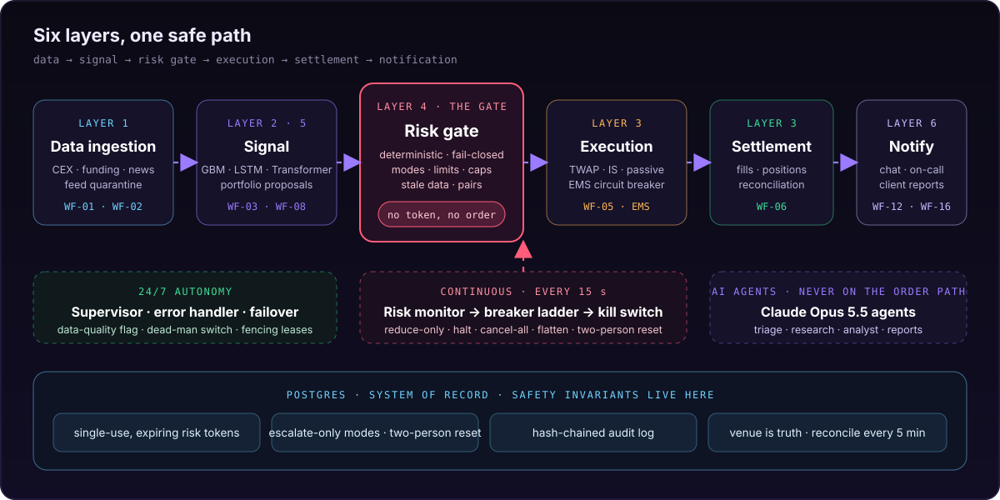
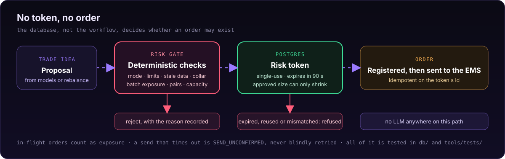
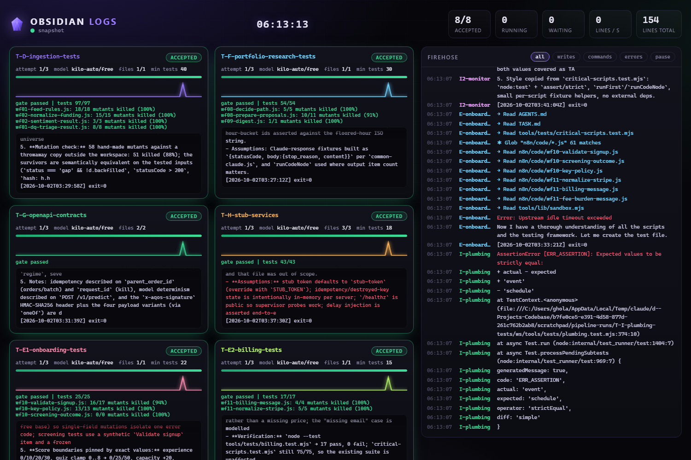

<div align="center">



<br>

**An AI-native, 24/7 control plane for systematic crypto trading.**<br>
Institutional-style risk control, packaged as software for individuals.

<br>

[](https://n8n.io)
[](https://www.postgresql.org)
[](https://redis.io)
[](https://www.anthropic.com)
[](https://nodejs.org)
[](https://www.docker.com)


[**Blueprint**](docs/blueprint.md) &nbsp;·&nbsp; [**Business strategy**](docs/business-strategy.md) &nbsp;·&nbsp; [**Handoff**](docs/HANDOFF.md) &nbsp;·&nbsp; [**Service contracts**](docs/openapi) &nbsp;·&nbsp; [**Quick start**](#-quick-start)

</div>

---

## Why this exists

Self-directed crypto investors want systematic strategies that run around the clock, but they have to trade control for sophistication: hand over custody, or settle for a simple bot. AQOS runs strategies **inside the client's own exchange accounts** through trade-only API keys, and enforces the client's limits with code that can't be talked out of it.

<table>
<tr>
<td width="33%" valign="top">

### Risk first
Every order must pass a deterministic gate and carry a **single-use, expiring token** minted by the database. No token, no order.

</td>
<td width="33%" valign="top">

### Always on
A supervisor heartbeat, circuit breakers, kill switch, error handler and idempotent retries are built into the workflows, not bolted on.

</td>
<td width="33%" valign="top">

### Honest by design
AI agents can tighten limits and demote models, never loosen or promote. A compliance gate checks every client message. No performance is promised.

</td>
</tr>
</table>

## Architecture



## The safety gate



The database, not the workflow, decides whether an order may exist. A buggy or compromised workflow cannot bypass it, and the rules are covered by tests:

| Invariant | Where it lives | Tested |
|---|---|---|
| Orders need an unexpired, unused, matching risk token | `oms.submit_parent_orders` | yes |
| Risk modes only escalate; lifting a halt needs two approvers | `risk.apply_mode` | yes |
| Agents may only tighten limits; model promotions need a human | `risk.propose_limit_change`, `research.propose_transition` | yes |
| In-flight orders count as exposure; a timed-out send is never blindly retried | `risk.gate_context`, `oms.mark_unconfirmed` | yes |
| A billing lapse moves accounts to reduce-only and never liquidates | `biz.apply_billing_event` | yes |
| Tamper-evident audit log | `ops.verify_audit_chain` | yes |

## The 17 workflows



Workflows are written as code (`n8n/specs/`), generated into importable JSON, and checked against the real n8n 2.41.4 node catalog: every node type, version, parameter, credential, SQL function and Code-node reference. A validator that fails on 16 of 16 injected faults is part of the test suite, so "0 errors" means something.

## Reality check

| | Status |
|---|---|
| ✅ Postgres schema, safety invariants, 74 tests | **Built and tested** |
| ✅ 17 n8n workflows (285 nodes), 61 Code-node scripts, 379 logic tests | **Built and tested** |
| ✅ Business strategy, blueprint, deploy files, handoff | **Written** |
| 🟡 OpenAPI contracts for 13 service endpoints, deterministic stubs | **Drafted by agents; needs human review** |
| ⬜ Live n8n dry run | **Not done** (needs Docker) |
| ⬜ Execution, risk, model, portfolio, data and stream services | **Not built** |
| ⬜ Trading strategies | **Not implemented or backtested; no performance evidence exists** |

## Built with a free-model agent team

Part of this repo (about 300 of the tests, the OpenAPI contracts and the stub server) was written by free-model agents (Kilo Code, Hermes, OpenCode) orchestrated behind an **automatic acceptance gate**: a worker's output is accepted only if its tests pass, it touched no other file, and an automated mutation check shows its tests actually catch broken code. Tasks that were too big for a free model were split and retried automatically. A live view of the team is included:

<div align="center">

</div>

`node tools/monitor.mjs <runsDir>` serves it at `http://127.0.0.1:8787` (local only, streams every 500 ms).

## 🚀 Quick start

```bash
npm install
npm run verify        # build workflows, validate against n8n 2.41.4, run every test
```

<details>
<summary><b>All commands</b></summary>

| Command | What it does |
|---|---|
| `npm run build` | Generate `n8n/workflows/*.json` from `n8n/specs/*.spec.mjs` |
| `npm run validate` | Check every node, parameter, credential, SQL function and Code script; writes `docs/feasibility.json` |
| `npm run test:db` | Run `db/schema.sql` in PGlite (Postgres 17) and check the safety invariants |
| `npm run test:validator` | Prove the validator fails on broken workflows |
| `npm run test:logic` | Unit tests for all Code-node scripts |
| `npm run credentials` | Write `deploy/credentials.template.json` (placeholders only) |
| `node tools/check-openapi.mjs docs/openapi` | Structural check of the 13 service contracts |
| `node tools/mutation-check.mjs` | Break the risk gate on purpose; the tests must fail every time |
| `bash orchestration/pipeline.sh` | Run the free-model agent team unattended behind the acceptance gate |
| `node tools/monitor.mjs <runsDir>` | Obsidian Logs, the live agent-team UI |

</details>

<details>
<summary><b>Deploy (reference, single host)</b></summary>

1. `cp deploy/.env.example deploy/.env` and fill in secrets. Copy `deploy/config.example.json` to `deploy/config.json` and edit.
2. `docker compose -f deploy/docker-compose.yml --env-file deploy/.env up -d`
3. Load the schema: `psql "$DATABASE_URL" -f db/schema.sql`. Do **not** load `db/seed_example.sql` outside development: its limits are placeholders.
4. Import credentials, then workflows, inside the n8n container:
   `n8n import:credentials --input=deploy/credentials.template.json` then `n8n import:workflow --separate --input=n8n/workflows`. Fill in the real secrets in n8n. Workflow ids are fixed, so sub-workflow links resolve.
5. Publish the workflows marked active. In queue or multi-main mode, `--activeState=fromJson` can do it at import.
6. Build the custom services listed in `docs/feasibility.json`, or add `deploy/docker-compose.stubs.yml` for a dry run against the deterministic stubs.

The risk limits in `risk.limits` must be calibrated and approved by a risk committee before any live use.

</details>

<details>
<summary><b>Repository layout</b></summary>

```
db/            schema.sql, seed_example.sql
n8n/specs/     workflows as code (DSL in tools/lib/dsl.mjs)
n8n/code/      Code-node scripts (shared helpers inlined with //@include)
n8n/workflows/ generated, importable JSON
tools/         builder, validator, mutation checks, stub services, monitor, tests
deploy/        compose files, config and credential templates
docs/          blueprint, strategy, handoff, OpenAPI contracts, assets
orchestration/ task briefs, dispatcher and acceptance gate for the agent team
```

</details>

## Documentation

| Document | What's in it |
|---|---|
| [docs/blueprint.md](docs/blueprint.md) | Business model, six-layer architecture, quant grounding, agent specifications, n8n topology, reliability design, feasibility check |
| [docs/business-strategy.md](docs/business-strategy.md) | Five-cycle strategy with an assumptions ledger and open questions |
| [docs/HANDOFF.md](docs/HANDOFF.md) | State of the project, design decisions, what each agent route can and can't do, next actions |
| [docs/openapi/](docs/openapi) | OpenAPI 3.1 contracts for the 13 custom service endpoints |
| [docs/feasibility.json](docs/feasibility.json) | Every n8n node type used and every endpoint that needs custom development |

---

<div align="center">


<sub>Not investment advice. Digital assets are volatile and capital can be lost. Nothing in this repository is a recommendation or a promise of returns.</sub>

</div>
