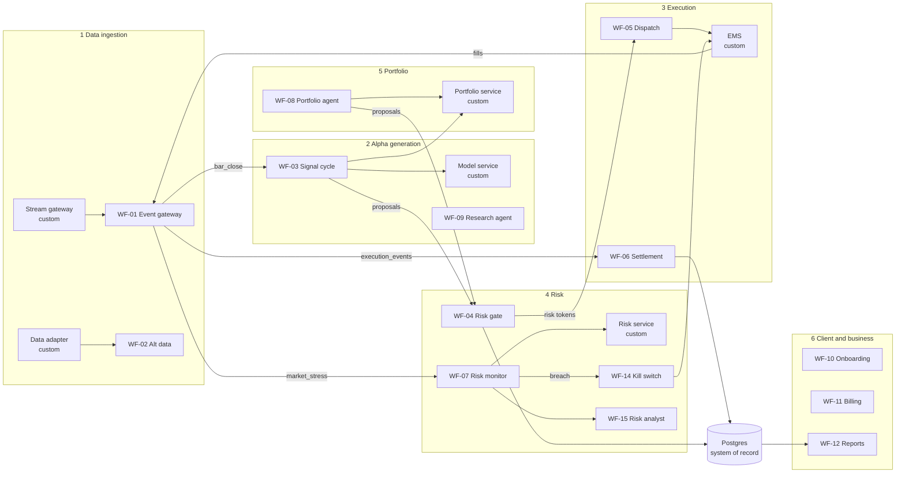
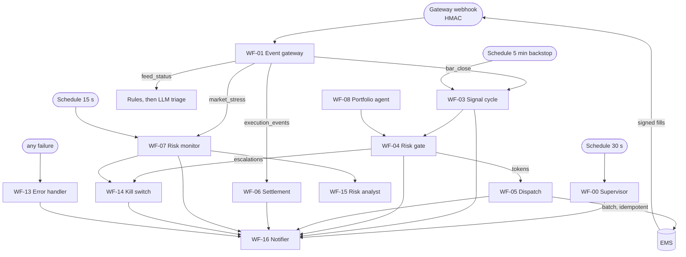

# AQOS Blueprint: an AI-native, 24/7 quantitative trading operating system

Version 0.1, 2 October 2026. Audience: the founder, engineers who will build the custom services, and investors or partners reviewing the plan.

AQOS runs systematic crypto strategies inside each client's own exchange accounts, with institutional-style risk control, and is sold as software to individuals. This document joins three things that are usually written separately: the business model, the six-layer system, and the n8n workflows that run it around the clock.

## 0. What is real today

This blueprint ships with working artifacts. The table separates what was executed from what is still a design.

| Item | State | Evidence |
|---|---|---|
| Postgres schema: 45 tables, 53 functions | Built and tested | 74 of 74 invariant tests pass in PGlite (Postgres 17), `npm run test:db` |
| 17 n8n workflows, 285 nodes, generated from specs | Built, validated | 0 errors against the n8n 2.41.4 node catalog; the validator itself fails on 16 of 16 injected faults |
| 61 Code-node scripts (1,695 lines) | Written and unit-tested; every script is covered by a test | 379 logic tests pass; mutation checks catch 8 of 8 deliberate breaks of the risk gate and 6 of 6 in other critical scripts; free-model tests also had to kill at least half of automatic mutants (section 9) |
| Business strategy (5-cycle loop) | Written | [business-strategy.md](business-strategy.md) |
| A live n8n instance running the workflows | **Not done** | Import and a dry run are the first step of the build plan |
| Custom services (EMS, risk, model, portfolio, stream gateway, data adapter) | **Contracts and stubs only; not built** | 13 endpoints in [feasibility.json](feasibility.json); OpenAPI 3.1 contracts in `docs/openapi/`; a deterministic stub server `tools/stub-services.mjs` whose outputs are tested against the real scripts that consume them |
| Strategy backtests or live performance | **None exist** | No return, Sharpe or capacity figure appears anywhere in this repo, by design |

The honest summary: the control plane and its safety invariants are built and tested; the market-facing services are specified, not built.

---

## 1. Business strategy in one page

Full version: [business-strategy.md](business-strategy.md).

**Product.** Software that executes systematic strategies in the client's own exchange accounts through trade-only API keys. AQOS never takes custody, never pools money, and never sells signals.

**Revenue.** Flat subscription tiers: Lab (free paper trading), Core, Pro, Desk. Usage credits for research runs. B2B licensing to licensed advisers. Performance fees only through a licensed partner and only for qualified clients (Phase 2). Pricing figures are open: `[fill-in: price points after a willingness-to-pay test]`.

**Why it is win-win: mechanisms that are built, not promised.**

| Promise to the client | Mechanism in the system | Verified by |
|---|---|---|
| Fees stay small relative to your capital | Weekly guardrail emails clients whose annual fee exceeds 2% of connected capital | `biz.fee_burden_report`, tested |
| A billing problem never liquidates you | A lapsed subscription moves accounts to reduce-only; payment lifts only that hold, never a risk halt | `biz.apply_billing_event`, tested |
| You prove it to yourself first | Everyone starts in paper mode; going live needs 14 paper days, a passed quiz, a risk disclosure and a verified key | `biz.graduation_candidates`, tested |
| Your limits are enforced | Client mandate limits are merged into every pre-trade check; the database refuses any order without a matching, unexpired risk token | `oms.submit_parent_orders`, tested |
| Nobody gets priority | Strategy capacity is shared pro-rata and dispatch order is shuffled each cycle | `wf04-pretrade-checks.js` |
| A kill switch exists and is checked | Halt, cancel-all, flatten, all verified against the EMS; reset needs two approvers | `risk.apply_mode`, WF-14 |
| Reports do not hype | A deterministic gate rejects promises, advice and any number not in your data | `wf12-compliance-gate.js` |
| The record cannot be quietly edited | Hash-chained audit log; tampering is detected at the edited row | `ops.verify_audit_chain`, tested |

**Acquisition flywheel.** Research content, then free paper Lab, then the graduation gate, then a paid live account. Disclosed referrals feed the top again. Execution data from live accounts sharpens impact and routing models, which improves outcomes for everyone.

**Compliance positioning.** Software infrastructure, not advice, with a legal opinion per jurisdiction before launch. The perimeter moves quickly:

| Jurisdiction | Fact | Status |
|---|---|---|
| EU | MiCA grandfathering ended 1 July 2026; advice and portfolio management in crypto-assets now need CASP authorisation | [Data-backed: ESMA] |
| UK | FCA published final cryptoasset rules on 30 June 2026; authorisation applications open September 2026; retail crypto derivatives are banned | [Data-backed: FCA] |
| US | Performance fees require "qualified clients": $1.4M AUM or $2.7M net worth for contracts from 29 June 2026 | [Data-backed: SEC order IA-6961] |
| US | The CLARITY Act failed a Senate cloture vote on 15 September 2026 | [Data-backed: Reuters] |
| US | CFTC-regulated perpetual-style futures launched July 2025; more perpetual approvals followed in May 2026 | [Data-backed: Coinbase, WSJ] |

Whether AQOS falls inside any of these perimeters depends on facts counsel must assess (control over orders, discretion, marketing). That is an assumption, not a conclusion.

---

## 2. Architecture: six layers

The thread that matters: **data, signal, risk gate, execution, settlement, notification**. A trade idea becomes an order only by passing through WF-04, and only the database can mint the single-use token that WF-05 spends.

### Layer summary

| # | Layer | Modules | AI components | n8n workflows | Custom services |
|---|---|---|---|---|---|
| 1 | Data ingestion | Websocket managers, ETL normalisers, feed registry and quarantine, funding and basis collector | Data-quality triage agent; news sentiment scorer | WF-01, WF-02 | Stream gateway, data adapter |
| 2 | Alpha generation | Factor library, feature store, walk-forward and paper trading, experiment ledger | Prediction ensemble (gradient boosting, LSTM, Transformer); research agent | WF-03, WF-09 | Model service, research sandbox |
| 3 | Execution | Order management, smart routing, TWAP / VWAP / implementation shortfall, passive-limit with reprice, exchange connectors | Market-impact and fill-probability models; no LLM on the order path | WF-05, WF-06 | EMS (active/standby) |
| 4 | Risk | Real-time P&L, drawdown breakers, VaR and ES, correlation monitor, margin and liquidation-distance monitor, depeg monitor | Anomaly detection; risk analyst agent | WF-04, WF-07, WF-14, WF-15 | Risk service |
| 5 | Portfolio | Capital allocation, position sizing, rebalancing with no-trade bands | Portfolio agent; online meta-learner | WF-08 | Portfolio service |
| 6 | Client and business | Onboarding, KYC screening, key policy, billing, dashboards, invoicing | Communication agent | WF-10, WF-11, WF-12 | Client portal, KYC provider |

Cross-cutting: WF-00 supervisor (system heartbeat), WF-13 error handler, WF-16 notifier.

### Layer 1: Data ingestion

- **Modules.** Websocket managers for CEX order books and trades, funding and open interest, on-chain flows, mempool and sentiment sources. ETL normalisers convert venue formats into one schema. A feed registry holds a trust flag per feed; a quarantined feed can be restored only by a human (`md.restore_feed` is not exposed to any workflow).
- **Validation agent.** Deterministic rules decide quarantine: checksum mismatch, crossed book, stale beyond 60 s (critical feeds) or 300 s, isolated outlier with MAD z above 8 and no other venue agreeing. An LLM then classifies the likely cause for the on-call engineer and may request a backfill; it cannot change trust.
- **Why rules decide.** A model that can un-quarantine a bad feed is a model that can be talked into trading on bad data.

### Layer 2: Alpha generation

- **Models.** LightGBM per horizon on engineered features (multi-horizon returns, realised volatility, funding and open-interest changes, basis, order-flow imbalance, on-chain flows, sentiment). A sequence model (LSTM or GRU) for short-horizon flow. A Temporal Fusion Transformer or PatchTST for multi-horizon quantile forecasts. A regime classifier (hidden Markov or Bayesian changepoint). Stacking with isotonic calibration. The contract is the schema WF-03 validates: `mu`, `sigma`, `p_up`, `q05`, `q50`, `q95` per model, symbol and horizon.
- **Validation protocol (design, not yet run).** Purged k-fold with embargo and combinatorial purged cross-validation, deflated Sharpe ratio and probability of backtest overfitting, with every trial counted in `research.trial_ledger`. No strategy reaches production without paper-trading evidence and a human sign-off.
- **Research agent.** Reviews model health daily; may demote (auto-approved) or propose promotion (always human). See section 4.

### Layer 3: Execution

- **Algorithms.** The dispatcher picks by urgency and size: implementation shortfall for high urgency; TWAP with a participation cap for orders above USD 25,000; a three-level limit ladder for smaller orders; post-only passive with reprice for low urgency. Venue state is the golden source; reconciliation adopts it.
- **Impact and fills.** A square-root impact model calibrated on AQOS's own fills, and a gradient-boosted fill-probability model for passive orders. These are statistical models, not LLMs.
- **Safety.** The EMS re-applies hard limits as the last line of defence, de-duplicates on `parent_order_id` (equal to the risk decision id), and arms exchange-side cancel-all timers (dead-man switches) on every venue that supports them `[verify per venue and product]`.

### Layer 4: Risk management

- **Three independent layers.** (1) Pre-trade gate, WF-04. (2) Continuous monitor, WF-07, every 15 seconds and on stress events. (3) EMS hard limits. Any one of them can stop trading.
- **Ladder.** T1 warn; T2 reduce-only; T3 halt with cancel-all; T4 controlled flatten, which beats a forced liquidation. Thresholds are configuration in `risk.limits` and are placeholders until the risk committee calibrates them.
- **Ratchet.** Escalation is automatic and immediate. De-escalation needs two distinct approvers, except that a subsystem may lift only the hold it set itself (billing, daily loss).
- **Measurement.** Filtered historical simulation for VaR, expected shortfall at 97.5%, dynamic correlation and an absorption ratio, liquidation distance in sigmas, stablecoin peg deviation, venue health. If the risk service is down, a database-only snapshot runs and a long streak of fallbacks is itself treated as "risk not measurable" and moves the system to reduce-only.

### Layer 5: Portfolio management

- **Allocation.** Hierarchical risk parity or risk-budgeted weights, volatility-targeted sizing with a fractional-Kelly cap, no-trade bands to control turnover.
- **Meta-learner.** An online allocation algorithm (multiplicative weights or a bandit) over strategy sleeves. Autonomy is bounded: at most 5 percentage points per strategy and 15% one-way turnover per day, enforced in code; beyond that, or if the reviewing agent flags it, a human approves with a single-use, 4-hour link.

### Layer 6: Client and business

- Onboarding validates jurisdiction, screening and consents; the appropriateness score caps the risk profile; everyone starts in paper mode.
- **API keys are checked at the venue**, not on the portal's word: trading allowed, withdrawals and transfers disabled, IP allowlist set. Anything else is rejected and the key destroyed.
- Reports: the communication agent writes only from the client's metrics and a deterministic gate decides if it is used.

---

## 3. Quantitative grounding

Each strategy is anchored in published research and then adapted to crypto's volatility and 24/7 structure. Nothing here claims a return; the point is to name the mechanism, its known failure mode, and where the code contains it.

| Strategy | Published basis | Crypto adaptation | Known failure mode | Contained by |
|---|---|---|---|---|
| Time-series momentum (`tsmom_v1`) | Moskowitz, Ooi and Pedersen (2012); Liu and Tsyvinski (2021) on crypto momentum | Volatility-targeted sizing (Moreira and Muir 2017); UTC bars with no session gaps; 5-minute decisions on slower signals | Momentum crashes at sharp reversals; whipsaw in range markets | Daily-loss and drawdown breakers; vol targeting; capacity cap |
| Cross-sectional momentum (`xsmom_v1`) | Jegadeesh and Titman (1993); Liu, Tsyvinski and Wu (2022) crypto factors | Liquid-universe filter; long-short via perpetuals only where the client's jurisdiction allows | Crowding; short squeezes; listing and delisting events | Restricted-symbol list; per-venue caps; jurisdiction gate |
| Statistical arbitrage (`statarb_ou_v1`) | Gatev, Goetzmann and Rouwenhorst (2006); Avellaneda and Lee (2010) | Ornstein-Uhlenbeck spread on same-sector perpetual pairs; hedged pairs are executed all-or-none | Regime break; one leg depegs or delists | Pair rule in the gate (one rejected leg rejects both; shared hedge ratio); demotion on live-versus-backtest z at or below -2.5 |
| Funding-rate carry (`funding_carry_v1`) | He, Manela, Ross and von Wachter (2022) on perpetual futures pricing; Schmeling, Schrimpf and Todorov, BIS Working Paper 1087 (crypto carry) | Long spot, short perpetual when funding is positive; per-venue margin; funding collected every 8 hours | Funding flips; auto-deleveraging; exchange failure | Liquidation-distance breaker; venue cap; ADL events escalate to SEV1; collateral depeg breaker |
| Cross-exchange basis (`basis_xex_v1`) | Makarov and Schoar (2020) on arbitrage across crypto venues | Capital is held on each venue; no transfers during the trade | Capital immobility; withdrawal suspension | Counterparty breaker moves a venue to reduce-only on suspended withdrawals |
| Execution | Almgren and Chriss (2000); square-root impact law | TWAP and implementation shortfall with participation caps | Slippage in thin books | Price collar, slippage alerts, SEND_UNCONFIRMED handling |
| Portfolio | López de Prado (2016) hierarchical risk parity; Kelly criterion | Fractional Kelly; no-trade bands | Estimation error | Bounded daily change; human approval beyond the envelope |
| Validation | Bailey and López de Prado (2014) deflated Sharpe; Bailey, Borwein, López de Prado and Zhu (2017) | Trial ledger counts every hypothesis tried | Overfitting | Promotion gate; paper-first; human sign-off |

The 10 October 2025 crash, with about $19 billion of liquidations and widespread auto-deleveraging [Data-backed: FTI Consulting, CoinDesk Data], is the design reference for the risk layer: leverage limits, liquidation-distance monitoring and venue caps exist because that event happened.

---

## 4. Agentic AI specification

**Model for every LLM route:** Claude Opus 5.5 (`claude-opus-5-5`). Structured outputs (JSON schema) guarantee parseable responses. On the direct API calls, `fallbacks: "default"` re-runs a declined request on Anthropic's recommended fallback model. Thinking is adaptive; effort is set per route. Forced tool use is not used (Opus 5.5 rejects it).

**Autonomy scale.**
- **L0** advises, human acts.
- **L1** acts inside a fixed envelope enforced in code.
- **L2** acts, then notifies; the action can only tighten (ratchet).
- **L3** proposes; a human approves with a single-use token.

No agent is above L3, and no LLM sits on the path that creates an order.

| Layer | Agent | Model and effort | Input | Output schema | Autonomy | n8n path | Guardrails |
|---|---|---|---|---|---|---|---|
| 1 | Data-quality triage | Opus 5.5, low | Incident telemetry: `feed_id, status, detail, action` | `cause_class, confidence, summary, recommended_actions[], request_backfill, backfill_minutes` | L1: may request a backfill, may not change trust | WF-01: Feed rules, Claude DQ triage, DQ triage result, Request backfill | Rules already quarantined; refusal or invalid JSON falls back to the rule text |
| 1 | Sentiment scorer | Opus 5.5, low | Up to 40 new headlines, treated as untrusted text | `scores[]: hash, asset, score, relevance, event_type` | L0: writes a feature only | WF-02: Build sentiment request, Claude, Sentiment result, `alt.record_sentiment` | Asset enum; hashes must belong to the batch; scores clipped to [-1, 1]; never places orders |
| 2 | Prediction ensemble | Gradient boosting, LSTM, Transformer (not an LLM) | Feature vectors at bar close | `predictions[]: model_id, model_version, symbol, horizon, mu, sigma, p_up, q05, q50, q95` | L1 | WF-03: Request predictions, Validate predictions | Fail-closed validation: stale, malformed or more than 20% rejected means no trading this cycle |
| 2 | Research agent | Opus 5.5, high, with Postgres read tools | Daily brief: model health, trial ledger, pending approvals | `date, summary, decay_findings[], results_reviewed[], transitions_proposed[]` | L2 for demotions, L3 for promotions | WF-09 (agent node with output parser) | Tools: model health, recent fills, `research.propose_transition`; read-only role |
| 3 | Execution models | Impact and fill-probability models (statistical) | Order, book state | Algorithm parameters | L1 | WF-05: Prepare dispatch | Hard limits re-checked by the EMS |
| 4 | Risk breakers | Deterministic code with anomaly detection | Risk snapshot | Mode changes and kill requests | L2: escalate only | WF-07: Evaluate breakers | Ratchet in SQL; de-escalation needs two approvers |
| 4 | Risk analyst | Opus 5.5, high, read-only tools | The breach that just fired | `severity_assessment, confidence, summary, probable_causes[], limits_tightened[], recommended_human_actions[]` | L2: may tighten a limit | WF-15 | `risk.propose_limit_change` refuses anything that loosens; breakers already acted |
| 5 | Portfolio agent plus meta-learner | Online allocator plus Opus 5.5 reviewer, medium | Proposed weights, current weights, diagnostics | `summary, concerns[], recommend_human_review` | L1 inside 5 pp and 15% turnover, else L3 | WF-08 | The reviewer can add caution but never remove it |
| 6 | Communication agent | Opus 5.5, medium | The client's own metrics for one period | `subject, summary_md, highlights[], risk_notes[]` | L1 | WF-12 | Compliance gate: banned phrases, numbers must exist in the data, no links, length caps; failure falls back to the template report |

**How agents trigger n8n paths.** They never call workflows directly. An agent returns structured data; deterministic nodes decide the next step. The only agent-initiated writes are three SECURITY DEFINER functions that can only tighten or auto-demote: `risk.propose_limit_change`, `research.propose_transition`, and `risk.apply_mode` for escalation (called by workflow code, not by an agent).

---

## 5. n8n workflow architecture

### Topology

### Workflow catalogue

| ID | Name | Trigger | Nodes | Purpose |
|---|---|---|---|---|
| WF-00 | Supervisor | Schedule 30 s | 17 | Probe services, read freshness, write data-quality and mode flags, alert on state change, dead-man ping |
| WF-01 | Event gateway | Webhook (HMAC, raw body) | 24 | Verify, de-duplicate, route events, run data-quality rules and LLM triage |
| WF-02 | Alternative data | Schedules 5 and 10 min | 16 | Funding and marks; headlines scored into features |
| WF-03 | Signal cycle | Sub-workflow plus cron backstop | 25 | One cycle per 5-minute bar, claimed idempotently |
| WF-04 | Risk gate | Sub-workflow | 12 | Pre-trade checks, risk tokens, escalations |
| WF-05 | Execution dispatch | Sub-workflow | 18 | Spend tokens, send idempotent batch, EMS circuit breaker |
| WF-06 | Settlement and reconciliation | Sub-workflow plus two schedules | 12 | Apply fills, reconcile to venues every 5 minutes, close the day |
| WF-07 | Risk monitor | Schedule 15 s plus sub-workflow | 20 | Breaker ladder, ratcheted modes, kills, analyst hand-off |
| WF-08 | Portfolio agent | Two schedules | 24 | Drift rebalance; daily allocation with approval link |
| WF-09 | Research agent | Schedule daily | 13 | Model-health review, memo |
| WF-10 | Client onboarding | Two webhooks plus schedule | 26 | Signup, screening, key policy, graduation invitations |
| WF-11 | Billing sync | Stripe trigger plus weekly schedule | 11 | Idempotent billing events; fee-burden guardrail |
| WF-12 | Client reports | Schedule daily | 13 | Narrative, compliance gate, email, record |
| WF-13 | Error handler | Error trigger | 9 | Classify, de-duplicate, set severity, fail-safe to reduce-only |
| WF-14 | Kill switch | Webhook plus sub-workflow | 28 | Halt, cancel, flatten, reset (four-eyes), verified and retried |
| WF-15 | Risk analyst agent | Sub-workflow | 12 | Explain and tighten after a breach |
| WF-16 | Notifier | Sub-workflow | 5 | Chat for everything, on-call page for SEV1 |

### Reliability design

**Retry matrix.** Retries are used only where the callee is idempotent.

| Call | Timeout | Retries | Why it is safe |
|---|---|---|---|
| EMS order batch | 10 s | 2 | EMS de-duplicates on `parent_order_id` |
| EMS kill | 15 s | 3 | Idempotent on `request_id` |
| Risk-service snapshot | 4 s | 1, then DB fallback | Read-only |
| Model and portfolio services | 60 s | 2 | Deterministic per `cycle_id` |
| Venue public data | 10 s | 2 | Read-only |
| Claude API | 90 to 120 s | none; falls back deterministically | Refusal, truncation, HTTP error or bad JSON all take the non-LLM path |
| Postgres function calls | default | 3 | All functions are idempotent by key |
| Notifications | default | 3 | A duplicate alert is acceptable; a lost one is not |

**Circuit breakers and fallbacks.**

| Breaker | Trips on | Does | Resets |
|---|---|---|---|
| EMS link (WF-05) | 3 failures in 120 s | Open for 30 s; dispatch skipped; failed sends become SEND_UNCONFIRMED, never re-sent blindly | Half-open probe after 30 s; success clears the counter |
| Market-data trust | Stale, crossed or checksum-failed feed | Feed quarantined; supervisor sets data quality DEGRADED; no new signal cycles | Human only |
| Risk measurement | 8 consecutive fallback snapshots, or stale marks | Global reduce-only | Two approvers |
| Capital breakers | VaR, ES, drawdown, depeg, liquidation distance, venue health | Reduce-only, halt, cancel-all or flatten | Two approvers (or the originating subsystem for daily-loss and billing holds) |
| Pipeline failure | SEV1 failure in WF-04 to WF-07 | WF-13 puts the system in reduce-only | Two approvers |
| Missing supervisor | Dead-man URL stops receiving pings | External alert | Automatic when pings resume |

**Failover for 24/7.**

- **n8n.** Queue mode with horizontally scaled workers. A multi-main setup for HA needs an n8n license [Data-backed: n8n docs]. The durable scheduler fires each schedule once across instances and applies a misfire policy; this blueprint uses "skip" for high-frequency triggers and a catch-up policy for daily jobs [Data-backed: n8n docs].
- **EMS.** Active/standby with a Postgres lease and a fencing epoch (`ops.try_acquire_lease`, `ops.check_fence`, tested): an old leader's requests are rejected.
- **Data stores.** Postgres should be a replicated or managed service; Redis runs with append-only persistence. If the Redis flags are lost, the supervisor rebuilds the global mode from the database within 30 seconds, and a missing data-quality flag fails closed until the supervisor writes it.
- **Idempotency everywhere.** Cycle ids, proposal ids, risk tokens (`decision_id` is the order id), event ids, Stripe event ids, kill request ids. Duplicate triggers and retries cannot double-trade.

### Feasibility check: is every node native?

Every n8n node used exists in n8n 2.41.4 and was checked against the real node definitions.

- **26 native node types:** Webhook, Respond to Webhook, Schedule Trigger, Execute Workflow and its trigger, Error Trigger, Stripe Trigger, HTTP Request, Code, IF, Switch, Set, Wait, Split in Batches, Crypto, Postgres and Postgres Tool, Redis, Slack, PagerDuty, Send Email, No-Op, plus the AI Agent, Anthropic Chat Model, Structured Output Parser and Think tool.
- **Nothing in n8n needs a custom node.** Everything outside n8n is a plain HTTP call, listed below.

**Custom development required (flagged):**

| Service | Endpoints called | What it must do |
|---|---|---|
| Stream gateway | `/v1/backfill`; pushes signed events to WF-01 | Websocket managers, normalisation, bar construction, feed-health events |
| Model service | `/v1/predict` | Feature pipeline and the model ensemble, deterministic per cycle |
| Portfolio service | `/v1/propose`, `/v1/rebalance`, `/v1/allocation/propose` | Optimiser, sizing, meta-learner |
| Risk service | `/v1/snapshot` | VaR, ES, correlation, liquidation distance, depeg, venue health |
| EMS | `/v1/orders/batch`, `/v1/kill`, `/v1/exposure`, `/v1/snapshots`, `/v1/keys/inspect`, `/v1/keys/destroy` | Exchange connectors, algos, dead-man timers, vault-backed signing, lease and fencing |
| Data adapter | `/v1/headlines` | Licensed news and on-chain alert providers behind one endpoint |
| KYC provider | `SCREENING_URL` | Sanctions and PEP screening |
| Vault signer | inside the EMS | API keys never reach n8n |

---

## 6. Controls summary

| Control | Where | State |
|---|---|---|
| Single-use, expiring risk tokens; token mismatch refusal | `oms.submit_parent_orders` | Tested |
| In-flight orders count as exposure (retries cannot double-count headroom) | `risk.gate_context` | Tested |
| Escalate-only modes; four-eyes de-escalation | `risk.apply_mode` | Tested |
| Agents may only tighten limits | `risk.propose_limit_change` | Tested |
| Demotions auto-approved, promotions need a human | `research.propose_transition` | Tested |
| Lease with fencing epoch | `ops.try_acquire_lease` | Tested |
| Tamper-evident audit log | `ops.verify_audit_chain` | Tested |
| Idempotent execution events; position and average-price math | `oms.apply_execution_events` | Tested |
| Venue truth adopted on reconciliation breaks | `oms.reconcile` | Tested |
| Gate logic: caps, batch accumulation, pairs, modes, stale data | `wf04-pretrade-checks.js` | 400 randomised batches plus mutation checks, tested |
| No secrets in workflow JSON; credentials by reference | `deploy/credentials.template.json` | Built |
| Agent database role is read-only on views | `aqos_agent_ro` | Defined; enforced by the validator on workflow nodes |

---

## 7. Build plan

| Step | Work | Needs |
|---|---|---|
| 1 | Run `npm run verify`; stand up n8n, Postgres and Redis from `deploy/docker-compose.yml`; import credentials and workflows; run every workflow against stub services | Day 1 to 3 |
| 2 | Build the EMS on one venue in paper mode: idempotent batch, kill, exposure, snapshots, dead-man timers | Weeks 1 to 4 |
| 3 | Build the stream gateway and a first model (trend and funding carry only) | Weeks 1 to 4 |
| 4 | Risk service: VaR, ES, liquidation distance, depeg | Weeks 2 to 5 |
| 5 | Kill-switch and failover drills; security review of key handling | Weeks 4 to 6 |
| 6 | Operator-capital pilot with published results | Weeks 6 to 10 |
| 7 | Legal opinions per jurisdiction, started in week 1 and gating any live client | `[fill-in: counsel]` |

Open inputs that block planning: budget, team, timeline and target jurisdictions (see D1 in the strategy document).

---

## 8. Repository map

| Path | Content |
|---|---|
| `db/schema.sql`, `db/seed_example.sql` | Schema and illustrative data (limits are placeholders, not recommendations) |
| `n8n/specs/*.spec.mjs` | Workflow definitions as code |
| `n8n/code/*.js` | The 61 Code-node scripts |
| `n8n/workflows/*.json` | Generated, importable workflows (`npm run build`) |
| `tools/validate-workflows.mjs` | Validator against the n8n 2.41.4 catalog |
| `tools/test-schema.mjs`, `tools/tests/` | Database and logic tests |
| `deploy/` | Compose file, env and config templates, credentials template |
| `docs/` | This blueprint, the strategy, `feasibility.json` |
| `orchestration/` | Task briefs and dispatcher used to delegate test-writing to free models |

Commands: `npm install`, then `npm run verify`.

---

## 9. Verification status and known gaps

- **Executed:** the SQL schema twice over (idempotent), 74 invariant tests; the validator on 17 workflows (0 errors) and on 16 deliberately broken ones (all 16 caught); a syntax check of all 61 scripts; 3 randomised risk-gate invariant tests (400 batches: never approves more than requested, never trades under HALT or on a stale mark, REDUCE_ONLY never increases exposure, deterministic); 75 unit tests for breakers, dispatch, the EMS breaker, the client-report compliance gate, bounded allocation, prediction validation, signed webhooks, the supervisor, error handling and the kill switch.
- **Mutation checks** (`node tools/mutation-check.mjs` and the in-repo script list): each safety rule is removed in turn and the tests must fail. 8 of 8 gate mutations and 6 of 6 mutations elsewhere were caught.
- **Delegated work (free-model team):** eight test and contract tasks were run unattended through Kilo Code with an automatic acceptance gate (tests pass, no other file touched, at least half of automatic mutants killed). All eight were accepted: ingestion, onboarding, billing, portfolio and research, two plumbing groups, the OpenAPI contracts and the stub services. Two tasks that were too large for a free model (timeouts) were split in two and then passed. One accepted test was flaky (it relied on an unseeded shuffle) and was fixed; every worker file was then run 20 times with no failures.
- **Not done, and why it matters:** no workflow has run inside a live n8n instance; Code-node `$('Node')` expressions, Postgres `queryReplacement` handling of JSON strings and the Wait-node approval link are the most likely places for a first-run surprise. The first build step is a dry run with stub services.
- **No performance evidence exists.** Any client-facing figure must come from audited paper or live-pilot records and carry the required disclosures.
